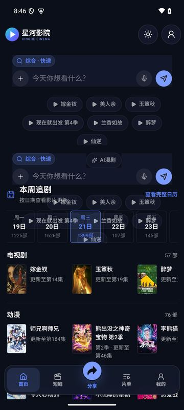
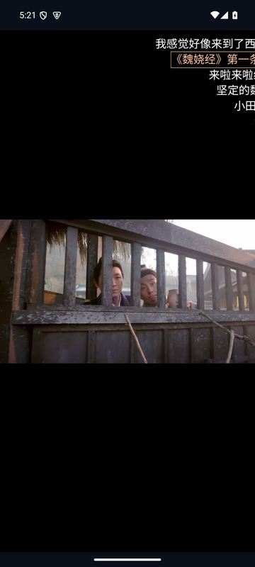
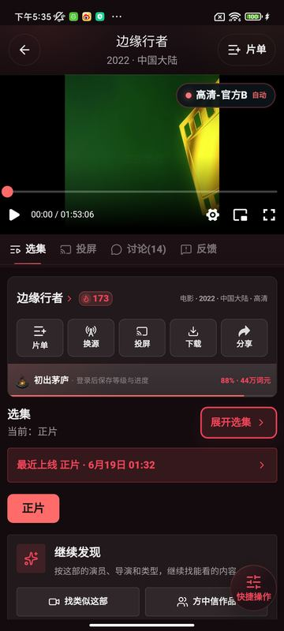
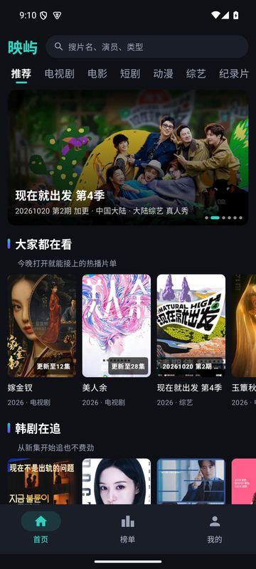
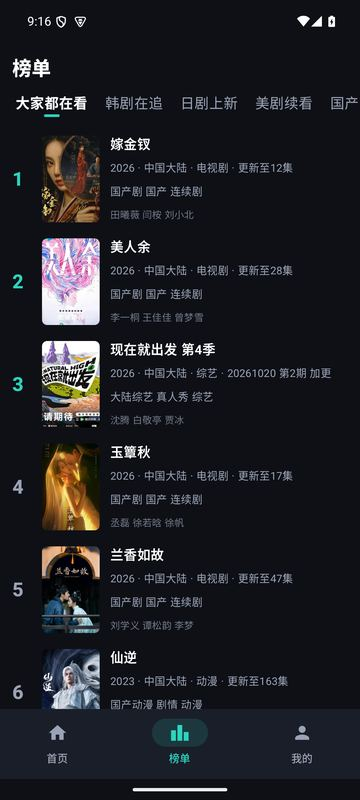
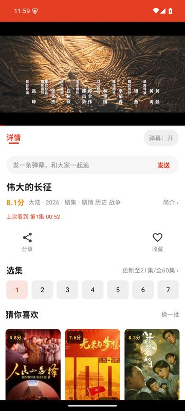

# 星河影院 / 赤焰影院 / 映屿 / 追光（Android）

4 款 Android 影视客户端：检索、选集、多线路切换、弹幕、续播。无需注册登录。

> 官方下载页：**https://codehyy.github.io/cinema-shell/**（三条直链自动择优，含安装教程）

## 下载

| 应用 | 版本 | 大小 | 系统要求 | 链接 |
|---|---|---|---|---|
| 星河影院 | 1.2 | 12.0 MB | Android 7.0+ | [下载页](https://codehyy.github.io/cinema-shell/xinghe.html) · [GitHub 直链](https://github.com/CodeHYY/cinema-shell/releases/download/v1.2/xinghe-1.2.apk) |
| 赤焰影院 | 1.2 | 12.0 MB | Android 7.0+ | [下载页](https://codehyy.github.io/cinema-shell/chiyan.html) · [GitHub 直链](https://github.com/CodeHYY/cinema-shell/releases/download/v1.2/chiyan-1.2.apk) |
| 映屿 | 1.3 | 23.2 MB | Android 8.0+ | [下载页](https://codehyy.github.io/cinema-shell/yingyu.html) · [GitHub 直链](https://github.com/CodeHYY/cinema-shell/releases/download/v1.2/yingyu-1.3.apk) |
| 追光 | 1.6 | 23.2 MB | Android 7.0+ | [下载页](https://codehyy.github.io/cinema-shell/zhuiguang.html) · [GitHub 直链](https://github.com/CodeHYY/cinema-shell/releases/download/v1.2/zhuiguang-1.6.apk) |

每个产品页都公布了安装包的 SHA-256，下载后可核对。安装包也可在 [Releases](https://github.com/CodeHYY/cinema-shell/releases) 获取。

## 截图

**星河影院**

 

**赤焰影院**

**映屿**

 

**追光**

 

> 截图为真实运行画面；影视封面来自第三方站点。

## 安装

1. 下载 `.apk` 并点开。
2. 系统提示「禁止安装未知来源应用」时，点「设置」，给浏览器/文件管理器打开「允许安装未知应用」。
3. 点「安装」。小米/华为/OPPO/vivo 与 Play 保护的提示处理方法见 [安装指南](https://codehyy.github.io/cinema-shell/index.html#install)。
4. 首次启动有隐私同意弹窗，可以拒绝，拒绝不影响观看。

## 更新

- 星河影院、赤焰影院：应用内「检查更新」。
- 映屿、追光：回下载页获取新版，直接覆盖安装（需与已装版本同一签名，数据保留）。

## 常见问题

- **要注册吗？** 不要。观看进度、收藏只保存在本机。
- **有广告吗？** 本版本集成第三方广告 SDK，首次启动征求同意，同意前不初始化，不同意不影响观看。详见 [隐私政策](https://codehyy.github.io/cinema-shell/privacy.html)。
- **内容从哪来？** 第三方公开站点；应用不存储、不上传任何视频。内容可能随时失效，可在播放页换线路。
- **无法播放/安装失败？** 见下载页 FAQ，或到 [Issues](https://github.com/CodeHYY/cinema-shell/issues) 反馈（注明产品、版本、手机型号）。

## 更新日志（当前版本）

**星河影院 1.2**
- 首次启动弹出隐私同意；同意前不初始化任何广告 SDK，不同意不影响观看
- 接入聚合广告 SDK（有填充才展示，无填充时静默放行）
- 新增广告 SDK 相关权限声明（定位、读取设备状态、振动等），详见隐私政策
- 隐私政策、用户协议已公布在本站

**赤焰影院 1.2**
- 首次启动弹出隐私同意；同意前不初始化任何广告 SDK
- 接入聚合广告 SDK（以最终构建为准）

**映屿 1.3**
- 接入 uni-AD 聚合广告 SDK；首次启动有隐私同意弹窗，可拒绝，不影响观看
- 隐私政策与用户协议已公布在本站

**追光 1.6**
- 接入 uni-AD 聚合广告 SDK
- 隐私政策与用户协议已公布在本站

## 其他

- [隐私政策](https://codehyy.github.io/cinema-shell/privacy.html) · [用户协议](https://codehyy.github.io/cinema-shell/terms.html)
- 运营者：剑透人生工作室，联系邮箱 hedd8681@gmail.com
- 权利人通知：请邮件提供权属证明与内容位置，核实后处理。

仓库的 `docs/` 目录即 GitHub Pages 站点（`update.json`、`ads.json` 为应用读取的配置，请勿手动改动格式）。
